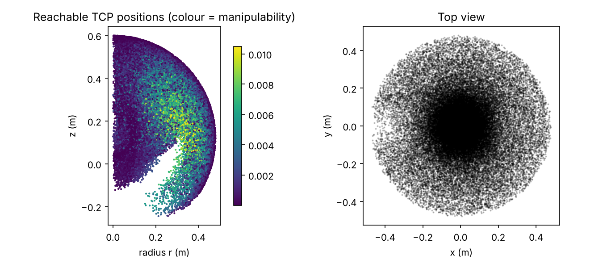
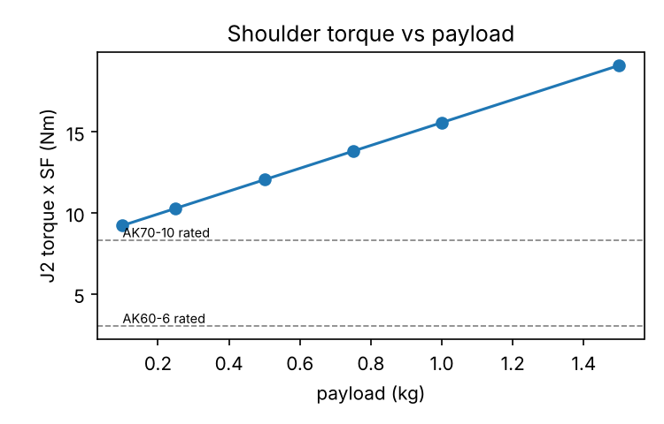
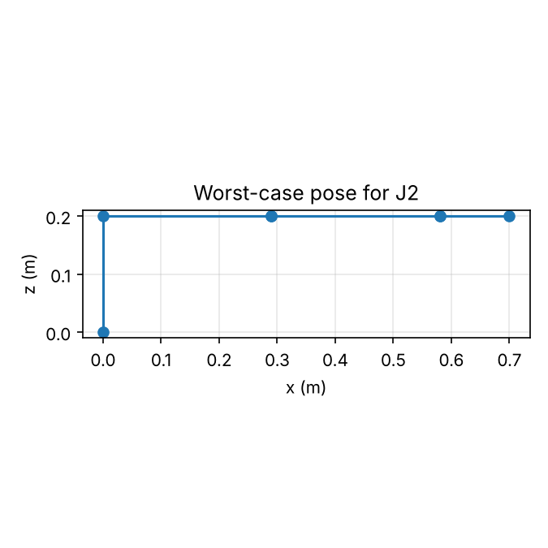

# Results (auto-generated by analysis/run_analysis.py)

Design assumptions come from `analysis/params.py`. Actuator numbers are approximate, see `analysis/actuators.py`.

- Geometry: d1=120 mm, a2=200 mm, d4=180 mm, d6=100 mm  ->  max reach from shoulder 480 mm
- Only modules with an integrated driver are considered; J1-J5 need a known backlash of at most 12 arcmin
- Total moving mass in the model: 3.19 kg (payload 0.5 kg)

## Worst-case joint torque

Random search of 30 000 poses inside the joint limits plus the stretched-out pose and a local refinement. Dynamic = static + M(q)*alpha with alpha = 5.0 rad/s^2 on every joint, safety factor 1.5. Actuator masses were fed back into the model until the selection stopped changing.

| Joint | static (Nm) | static+dyn (Nm) | rated needed (Nm) | peak needed (Nm) | actuator | rated margin |
|---|---|---|---|---|---|---|
| J1 | 0.00 | 1.71 | 0.00 | 2.57 | CubeMars AKH70-16 | n/a (point-mass model) |
| J2 | 8.03 | 10.52 | 12.05 | 15.78 | CubeMars AKH70-16 | 2.2x |
| J3 | 3.61 | 4.85 | 5.41 | 7.28 | CubeMars AK45-36 V3 | 1.5x |
| J4 | 0.59 | 0.79 | 0.88 | 1.19 | CubeMars AK45-36 V3 | 9.1x |
| J5 | 0.59 | 0.85 | 0.88 | 1.28 | CubeMars AK45-36 V3 | 9.1x |
| J6 | 0.00 | 0.00 | 0.00 | 0.00 | CubeMars AK45-36 V3 | n/a (point-mass model) |

J1 and J6 are listed from the point-mass model only: link rotational inertia is ignored, so their numbers are a lower bound. J1 also sees the whole arm's inertia about the vertical axis, so treat these two rows as a minimum, not a size.

Rule used: the *rated* (continuous) torque must cover the static holding torque x SF, and the *peak* torque must cover static+dynamic x SF.

## Tip error from gear backlash

Full backlash range of each joint turned into TCP displacement (mm) with the position Jacobian, over 3000 random poses plus the stretched-out pose. Joints without a datasheet figure use an assumed 15 arcmin (marked *).

| Joint | actuator | backlash (arcmin) | stretched pose (mm) | worst pose (mm) | median (mm) |
|---|---|---|---|---|---|
| J1 | CubeMars AKH70-16 | 12 | 1.68 | 1.68 | 0.50 |
| J2 | CubeMars AKH70-16 | 12 | 1.68 | 1.68 | 1.05 |
| J3 | CubeMars AK45-36 V3 | 12 | 0.98 | 0.98 | 0.85 |
| J4 | CubeMars AK45-36 V3 | 12 | 0.00 | 0.35 | 0.29 |
| J5 | CubeMars AK45-36 V3 | 12 | 0.35 | 0.35 | 0.35 |
| J6 | CubeMars AK45-36 V3 | 12 | 0.00 | 0.00 | 0.00 |

All joints combined: worst case (all at the limit, same direction) 4.7 mm, root-sum-square worst 2.6 mm, median 1.5 mm (full range, so roughly half of that as +/- around the commanded position).

Backlash alone does not meet a 0.5 mm goal, which is why the plan relies on camera feedback for the last step. Link deflection is not in this table yet.

## Payload sweep (shoulder J2 and elbow J3, static, x SF)

| payload (kg) | J2 (Nm) | J3 (Nm) |
|---|---|---|
| 0.1 | 9.23 | 3.76 |
| 0.25 | 10.29 | 4.38 |
| 0.5 | 12.05 | 5.41 |
| 0.75 | 13.82 | 6.44 |
| 1.0 | 15.58 | 7.47 |
| 1.5 | 19.11 | 9.53 |

## Workspace and singularities

- TCP height range: -245 .. 600 mm
- Max horizontal reach (sampled): 480 mm
- Max distance from base axis incl. all poses: 600 mm
Fraction of sampled poses within 10 degrees of a singularity (uniform in joint space, so the numbers say how much of the joint range is affected, not how much of a task space):

- wrist (J5 near 0): 8.8 %
- elbow (stretched / folded): 14.7 %
- shoulder (wrist centre within 30 mm of J1 axis): 18.3 %

## Inverse kinematics check

- 2000 random poses: max FK(IK(T)) - T error = 6.5e-14
- Solutions inside joint limits per pose: min 1, mean 3.61, max 8

